---
## Author
author:
  name: "Перегудов Александр Вадимович"
  degrees: DSc
  orcid: 0000-0002-0877-7063
  email: 1132239659@rudn.ru
  affiliation:
    - name: Российский университет дружбы народов
      country: Российская Федерация
      postal-code: 117198
      city: Москва
      address: ул. Миклухо-Маклая, д. 6

## Title
title: "Лабораторная работа № 2"
subtitle: "Компьютерный практикум по статистическому анализу данных"
license: "CC BY"
abstract: |
  В данном отчёте представлены результаты выполнения лабораторной работы по теме структур данных, реализованных в Julia.

  Описаны использованные методы, полученные экспериментальные данные и их анализ.

  Сделаны выводы о достижении поставленной цели.
keywords: [лабораторная работа, шаблон, Markdown, Pandoc]
---

# Введение

## Цель работы

Основная цель работы — изучить несколько структур данных, реализованных в Julia,
научиться применять их и операции над ними для решения задач.

# Теоретическая часть

# Выполнение лабораторной работы

Написал и исполнил код. (рис. -@fig-001)

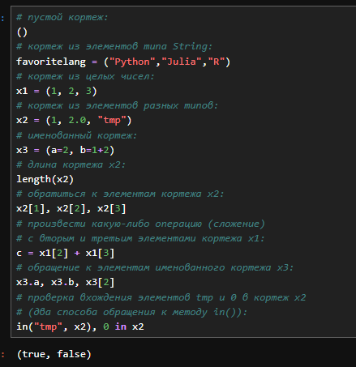{#fig-001 width=70%}

Написал и исполнил код. (рис. -@fig-002)

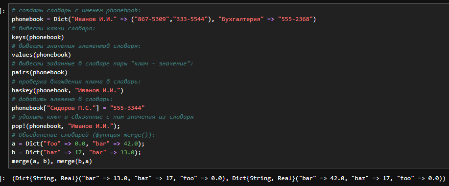{#fig-002 width=70%}

Написал и исполнил код. (рис. -@fig-003)

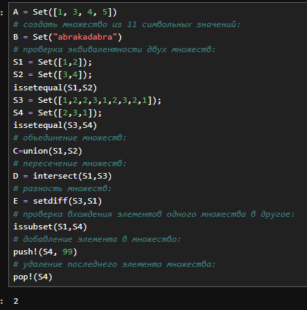{#fig-003 width=70%}

Написал и исполнил код. (рис. -@fig-004)

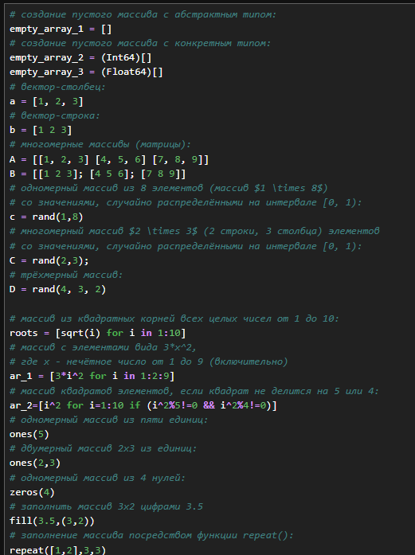{#fig-004 width=70%}

Написал и исполнил код. (рис. -@fig-005)

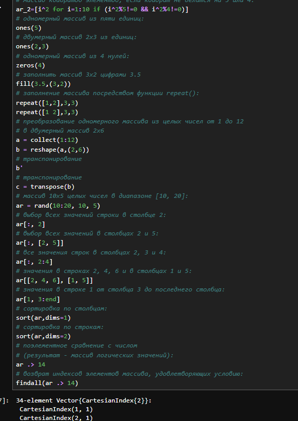{#fig-005 width=70%}

Написал и исполнил код. (рис. -@fig-006)

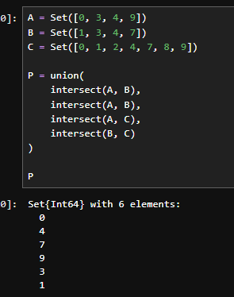{#fig-006 width=70%}

Написал и исполнил код. (рис. -@fig-007)

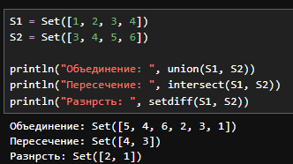{#fig-007 width=70%}

Написал и исполнил код. (рис. -@fig-008)

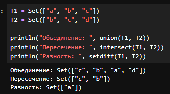{#fig-008 width=70%}

Написал и исполнил код. (рис. -@fig-009)

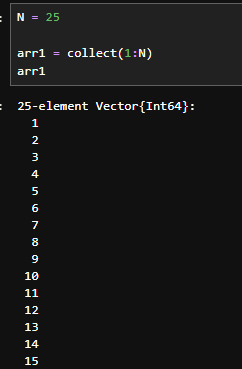{#fig-009 width=70%}

Написал и исполнил код. (рис. -@fig-010)

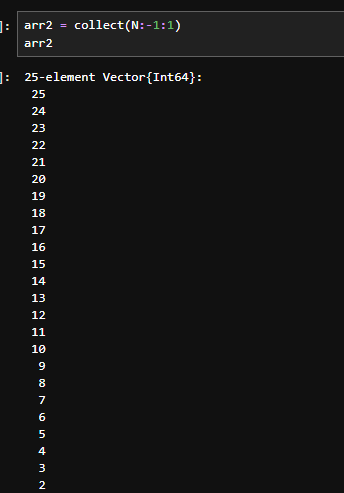{#fig-010 width=70%}

Написал и исполнил код. (рис. -@fig-011)

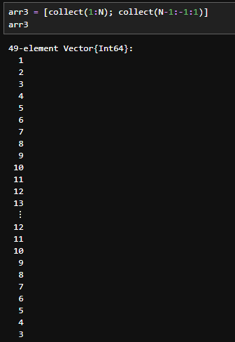{#fig-011 width=70%}

Написал и исполнил код. (рис. -@fig-012)

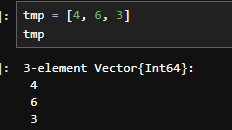{#fig-012 width=70%}

Написал и исполнил код. (рис. -@fig-013)

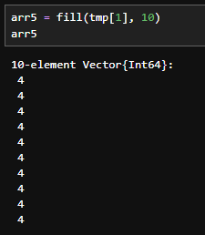{#fig-013 width=70%}

Написал и исполнил код. (рис. -@fig-014)

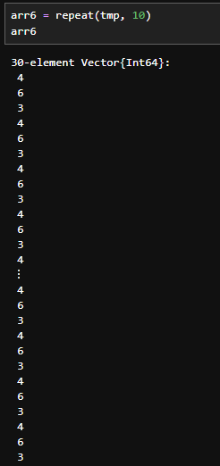{#fig-014 width=70%}

Написал и исполнил код. (рис. -@fig-015)

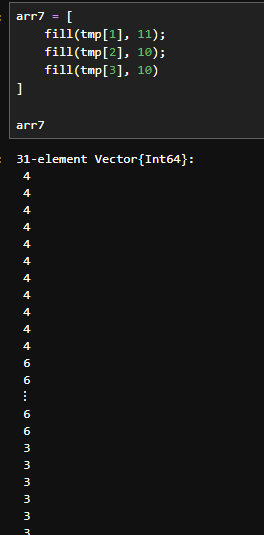{#fig-015 width=70%}

Написал и исполнил код. (рис. -@fig-016)

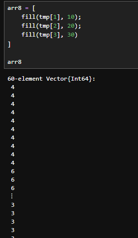{#fig-016 width=70%}

Написал и исполнил код. (рис. -@fig-017)

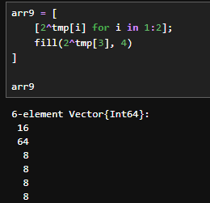{#fig-017 width=70%}

Написал и исполнил код. (рис. -@fig-018)

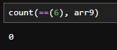{#fig-018 width=70%}

Написал и исполнил код. (рис. -@fig-019)

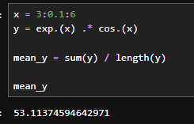{#fig-019 width=70%}

Написал и исполнил код. (рис. -@fig-020)

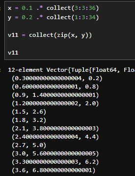{#fig-020 width=70%}

Написал и исполнил код. (рис. -@fig-021)

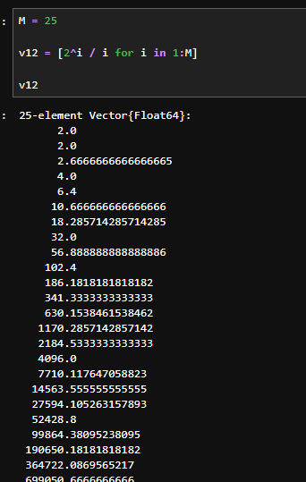{#fig-021 width=70%}

Написал и исполнил код. (рис. -@fig-022)

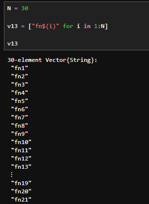{#fig-022 width=70%}

Написал и исполнил код. (рис. -@fig-023)

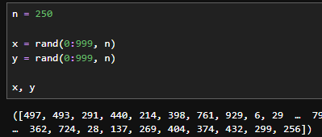{#fig-023 width=70%}

Написал и исполнил код. (рис. -@fig-024)

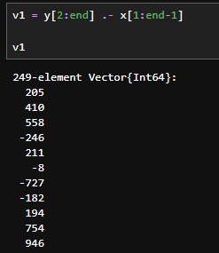{#fig-024 width=70%}

Написал и исполнил код. (рис. -@fig-025)

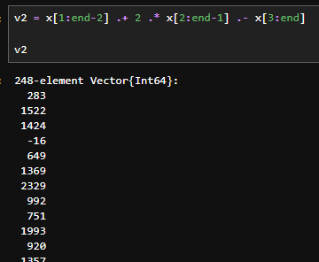{#fig-025 width=70%}

Написал и исполнил код. (рис. -@fig-026)

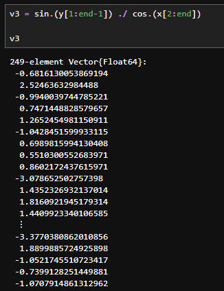{#fig-026 width=70%}

Написал и исполнил код. (рис. -@fig-027)

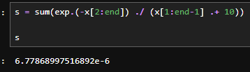{#fig-027 width=70%}

Написал и исполнил код. (рис. -@fig-028)

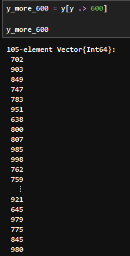{#fig-028 width=70%}

Написал и исполнил код. (рис. -@fig-029)

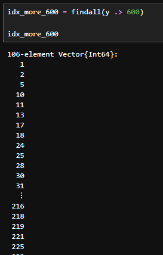{#fig-029 width=70%}

Написал и исполнил код. (рис. -@fig-030)

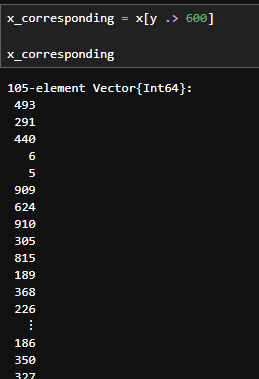{#fig-030 width=70%}

Написал и исполнил код. (рис. -@fig-031)

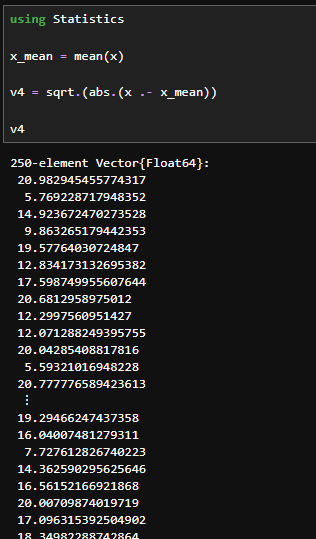{#fig-031 width=70%}

Написал и исполнил код. (рис. -@fig-032)

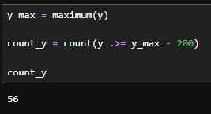{#fig-032 width=70%}

Написал и исполнил код. (рис. -@fig-033)

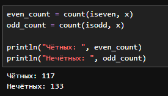{#fig-033 width=70%}

Написал и исполнил код. (рис. -@fig-034)

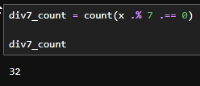{#fig-034 width=70%}

Написал и исполнил код. (рис. -@fig-035)

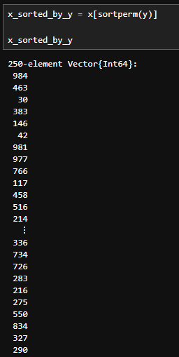{#fig-035 width=70%}

Написал и исполнил код. (рис. -@fig-036)

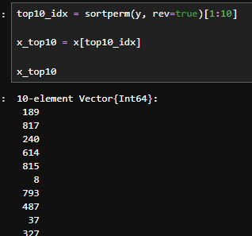{#fig-036 width=70%}

Написал и исполнил код. (рис. -@fig-037)

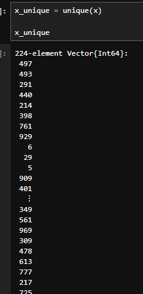{#fig-037 width=70%}

Написал и исполнил код. (рис. -@fig-038)

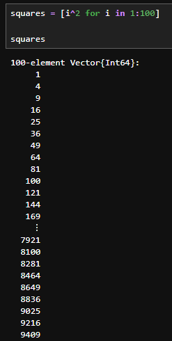{#fig-038 width=70%}

Написал и исполнил код. (рис. -@fig-039)

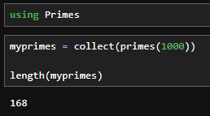{#fig-039 width=70%}

Написал и исполнил код. (рис. -@fig-040)

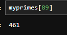{#fig-040 width=70%}

Написал и исполнил код. (рис. -@fig-041)

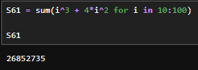{#fig-041 width=70%}

Написал и исполнил код. (рис. -@fig-042)

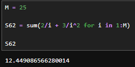{#fig-042 width=70%}

Написал и исполнил код. (рис. -@fig-043)

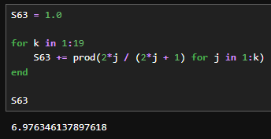{#fig-043 width=70%}

# Результаты

Здесь приводятся объективные данные, полученные в ходе работы.
Это могут быть таблицы с измерениями, графики, выводы программ, скриншоты.
Без интерпретации --- только констатация фактов.

# Обсуждение результатов

В этом разделе проводится анализ полученных результатов:

- сопоставление с теоретическими ожиданиями;
- сравнение с данными других авторов;
- объяснение возможных отклонений, погрешностей;
- практическая значимость результатов.

# Заключение

Были изучены несколько структур данных, реализованных в Julia.

# Список литературы {.unnumbered}

::: {#refs}
:::

