---
## Author
author:
  name: Перегудов Александр Вадимович
  orcid: 0000-0002-0877-7063
  email: 1132239659@rudn.ru
  affiliation:
    - name: Российский университет дружбы народов
      country: Российская Федерация
      postal-code: 117198
      city: Москва
      address: ул. Миклухо-Маклая, д. 6
## Title
title: "Лабораторная работа № 4"
subtitle: "Компьютерный практикум по статистическому анализу данных"
license: CC BY
date: today
date-format: "YYYY-MM-DD" # Example: 2025-09-06
---

# Информация

## Докладчик

:::::::::::::: {.columns align=center}
::: {.column width="70%"}

  * Перегудов Александр Вадимович
  * Российский университет дружбы народов им. П. Лумумбы
  * <https://github.com/magister6239/study_2026-2027_computer-practice>

:::
::: {.column width="30%"}

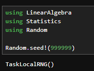

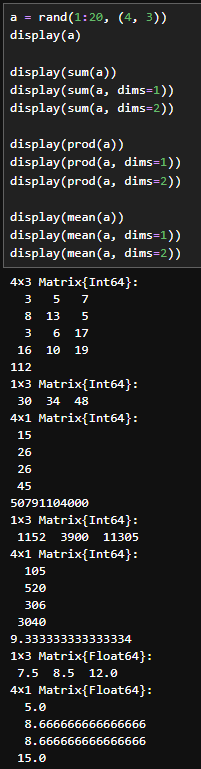

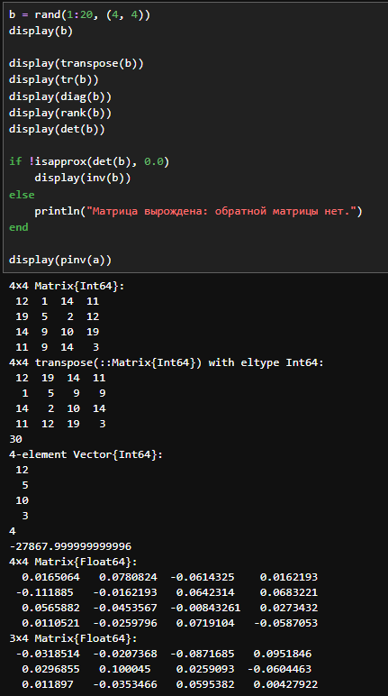

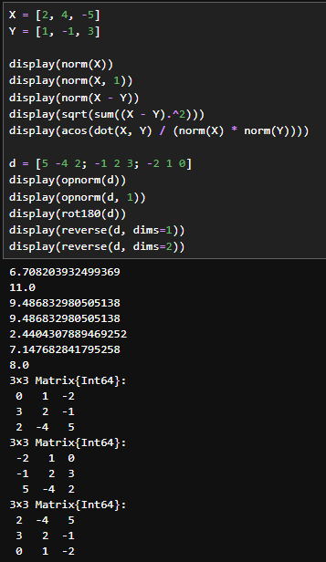

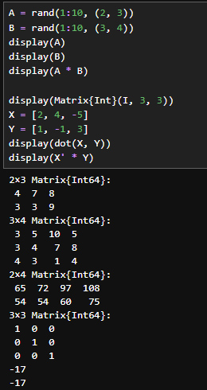

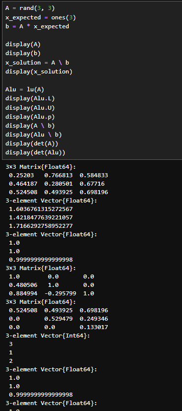

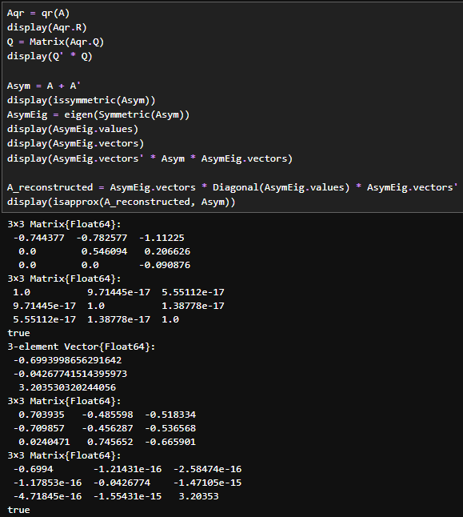

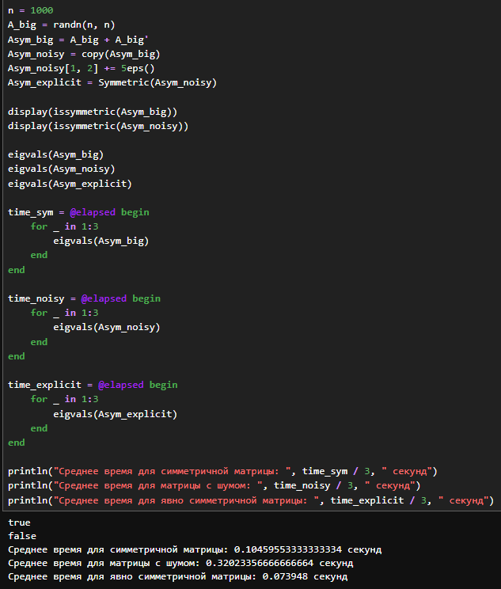

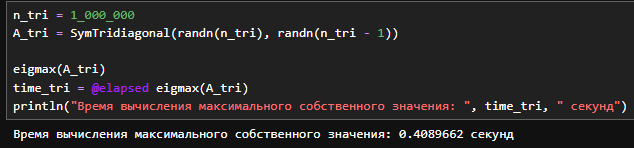

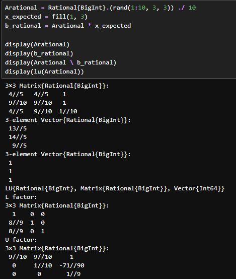

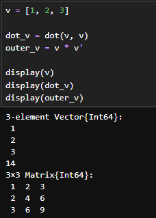

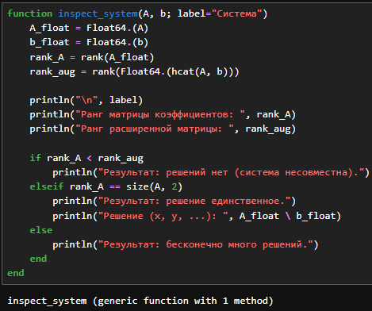

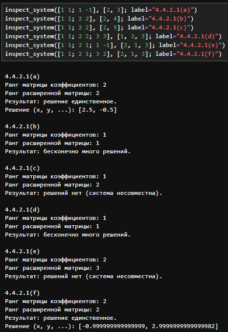

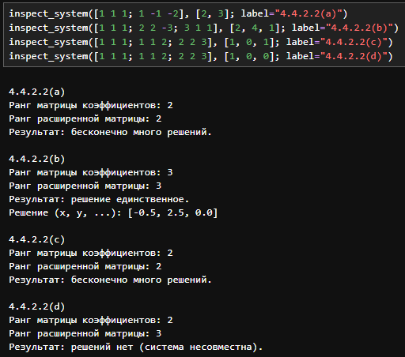

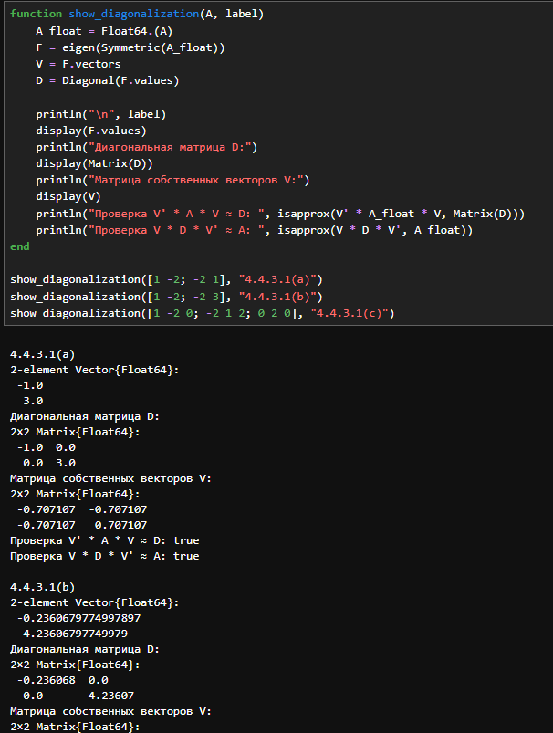

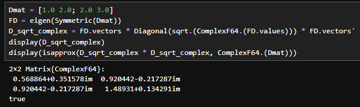

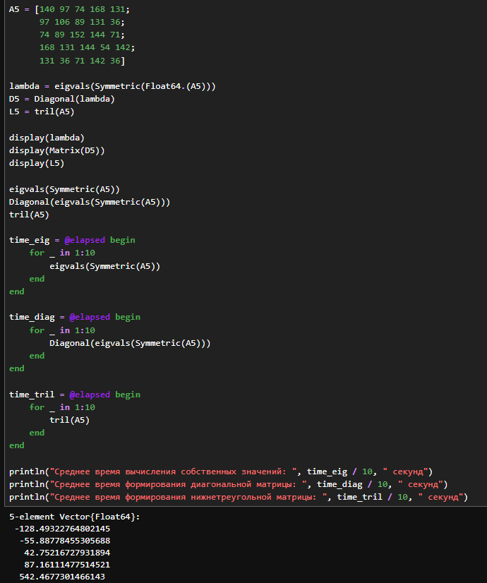

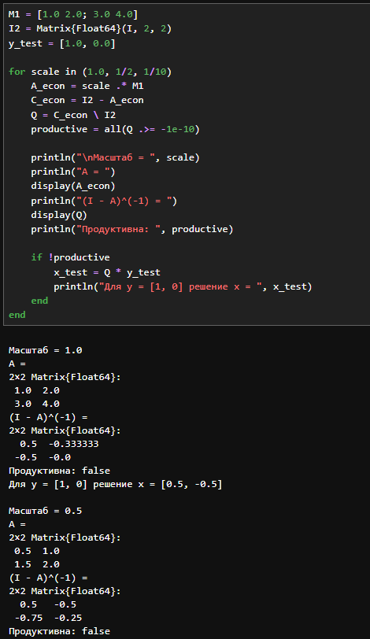

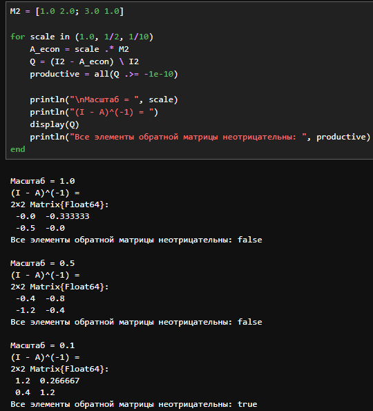

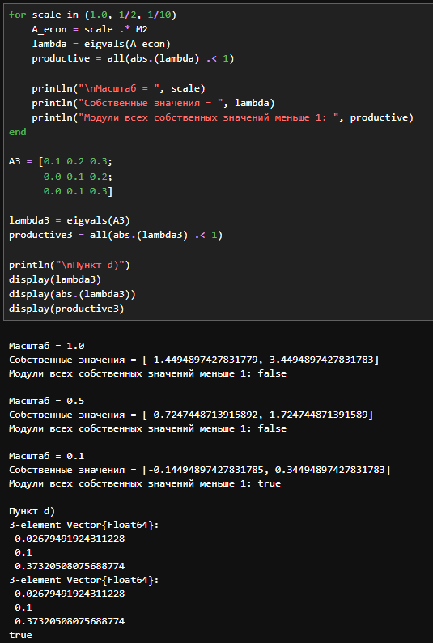

:::
::::::::::::::

## Объект и предмет исследования

- Julia

## Цели и задачи

Основной целью работы является изучение возможностей специализированных пакетов Julia для выполнения и оценки эффективности операций над объектами линейной
алгебры.

# Заключение

## Главный вывод

Были изучены возможностей специализированных пакетов Julia для выполнения и оценки эффективности операций над объектами линейной
алгебры.
