---
## Author
author:
  name: "Перегудов Александр Вадимович"
  degrees: DSc
  orcid: 0000-0002-0877-7063
  email: 1132239659@rudn.ru
  affiliation:
    - name: Российский университет дружбы народов
      country: Российская Федерация
      postal-code: 117198
      city: Москва
      address: ул. Миклухо-Маклая, д. 6

## Title
title: "Лабораторная работа № 4"
subtitle: "Компьютерный практикум по статистическому анализу данных"
license: "CC BY"
abstract: |
  В данном отчёте представлены результаты выполнения лабораторной работы по теме пакетов Julia для выполнения и оценки
  эффективности операций над объектами линейной алгебры.

  Описаны использованные методы, полученные экспериментальные данные и их анализ.

  Сделаны выводы о достижении поставленной цели.
keywords: [лабораторная работа, шаблон, Markdown, Pandoc]
---

# Введение

## Цель работы

Основной целью работы является изучение возможностей специализированных пакетов Julia для выполнения и оценки эффективности операций над объектами линейной
алгебры.

# Теоретическая часть

# Выполнение лабораторной работы

Написал и исполнил код. (рис. -@fig-001)

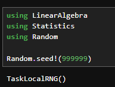{#fig-001 width=70%}

Написал и исполнил код. (рис. -@fig-002)

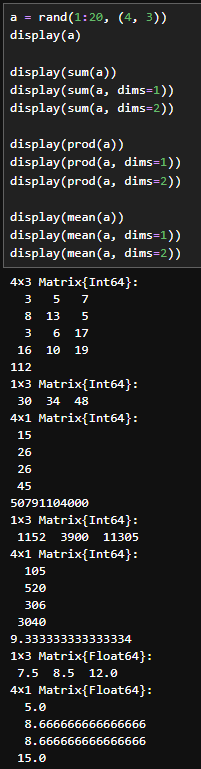{#fig-002 width=70%}

Написал и исполнил код. (рис. -@fig-003)

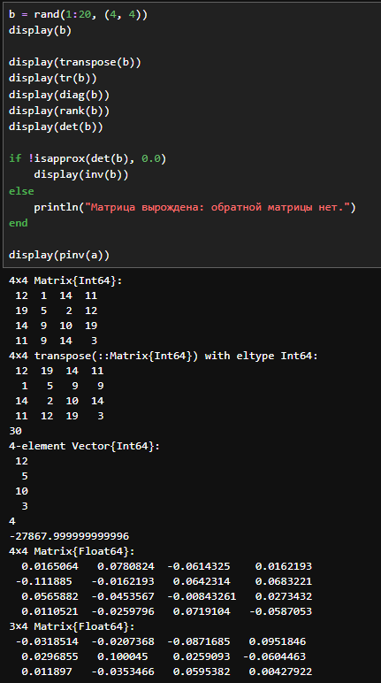{#fig-003 width=70%}

Написал и исполнил код. (рис. -@fig-004)

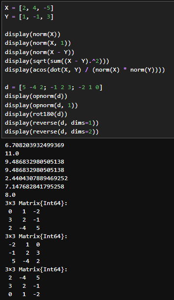{#fig-004 width=70%}

Написал и исполнил код. (рис. -@fig-005)

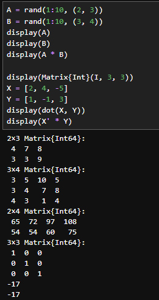{#fig-005 width=70%}

Написал и исполнил код. (рис. -@fig-006)

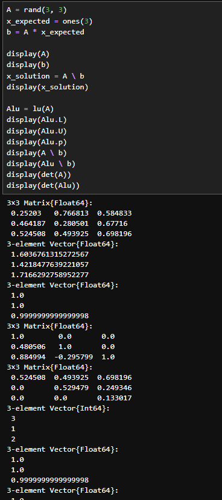{#fig-006 width=70%}

Написал и исполнил код. (рис. -@fig-007)

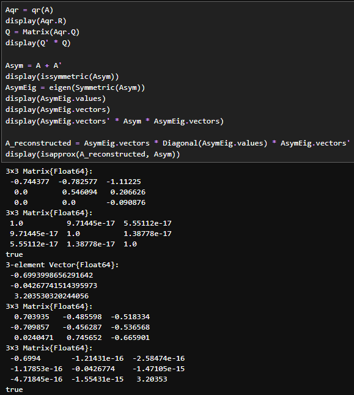{#fig-007 width=70%}

Написал и исполнил код. (рис. -@fig-008)

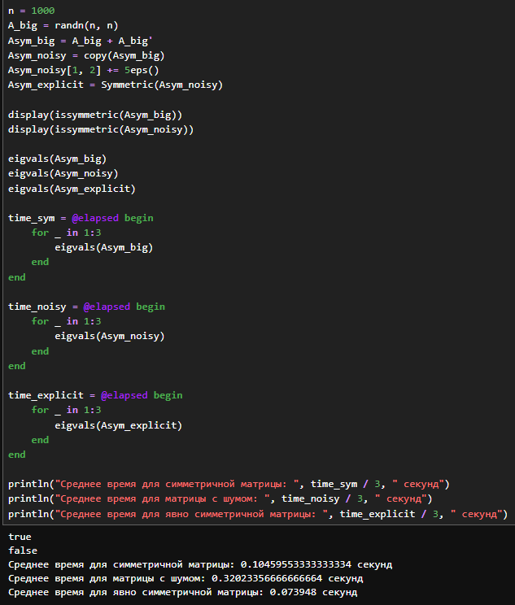{#fig-008 width=70%}

Написал и исполнил код. (рис. -@fig-009)

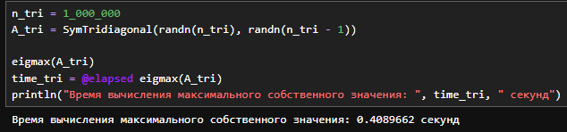{#fig-009 width=70%}

Написал и исполнил код. (рис. -@fig-010)

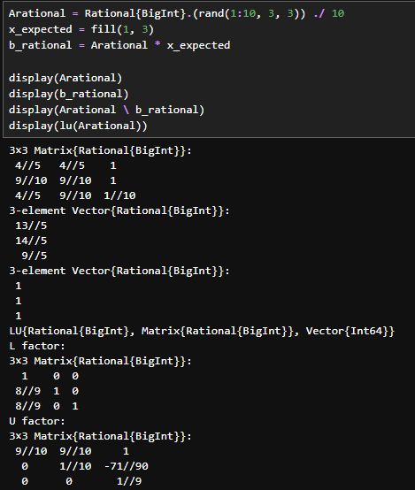{#fig-010 width=70%}

Написал и исполнил код. (рис. -@fig-011)

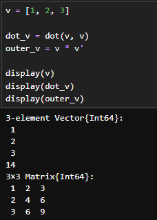{#fig-011 width=70%}

Написал и исполнил код. (рис. -@fig-012)

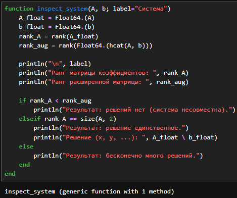{#fig-012 width=70%}

Написал и исполнил код. (рис. -@fig-013)

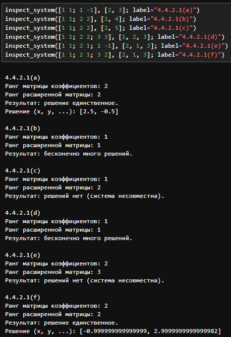{#fig-013 width=70%}

Написал и исполнил код. (рис. -@fig-014)

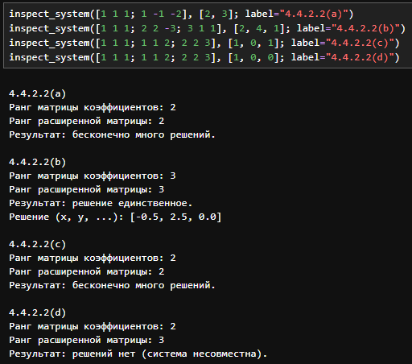{#fig-014 width=70%}

Написал и исполнил код. (рис. -@fig-015)

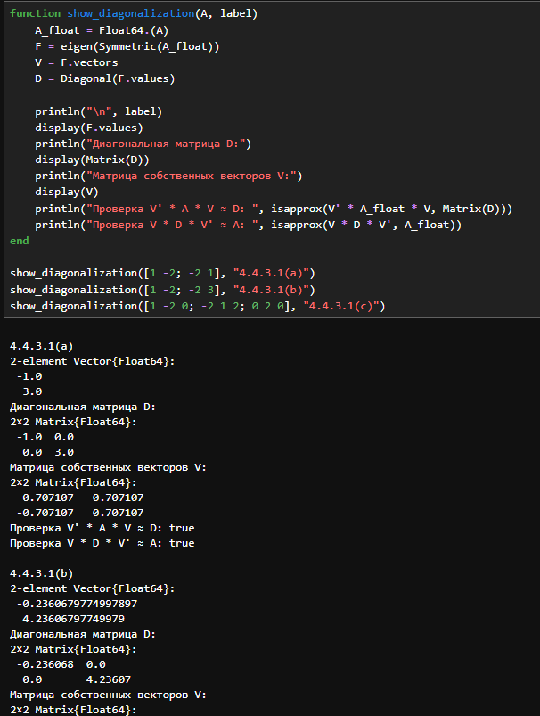{#fig-015 width=70%}

Написал и исполнил код. (рис. -@fig-016)

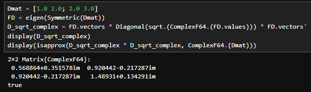{#fig-016 width=70%}

Написал и исполнил код. (рис. -@fig-017)

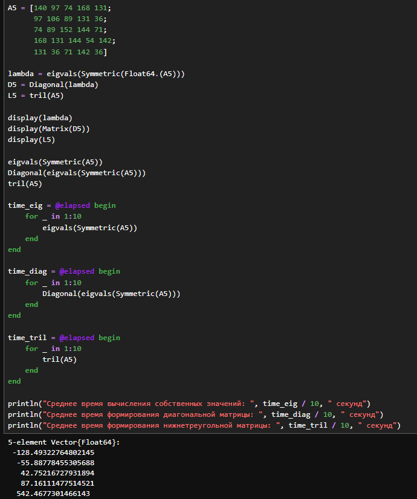{#fig-017 width=70%}

Написал и исполнил код. (рис. -@fig-018)

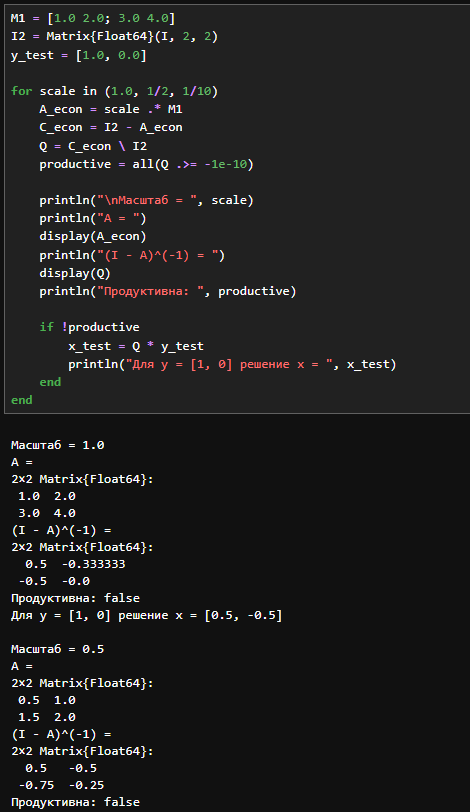{#fig-018 width=70%}

Написал и исполнил код. (рис. -@fig-019)

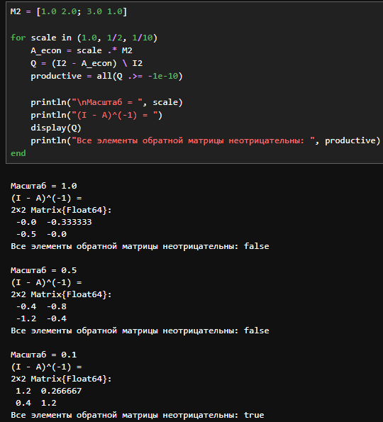{#fig-019 width=70%}

Написал и исполнил код. (рис. -@fig-020)

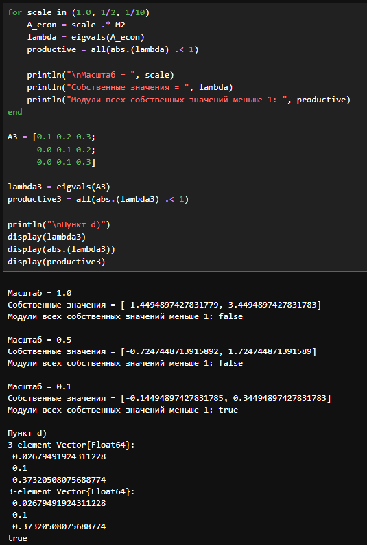{#fig-020 width=70%}

# Заключение

Были изучены возможностей специализированных пакетов Julia для выполнения и оценки эффективности операций над объектами линейной
алгебры.

# Список литературы {.unnumbered}

::: {#refs}
:::
